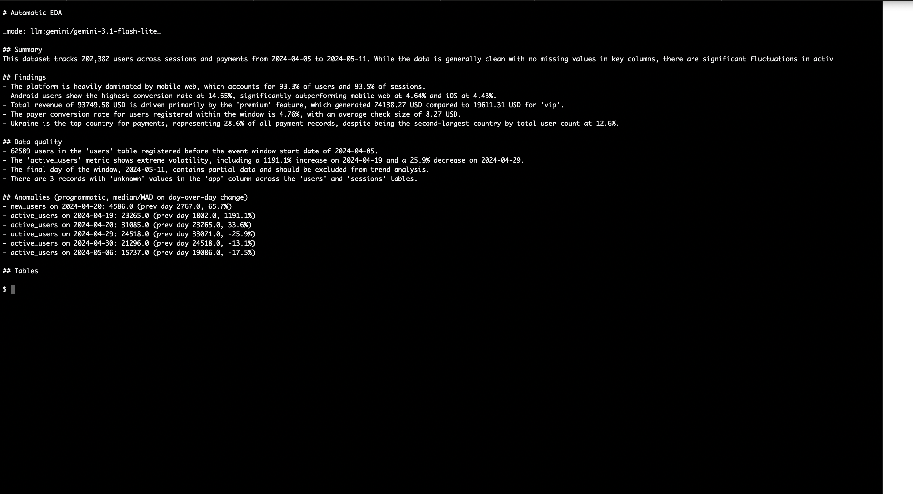
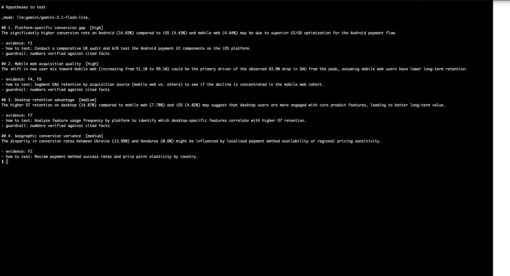
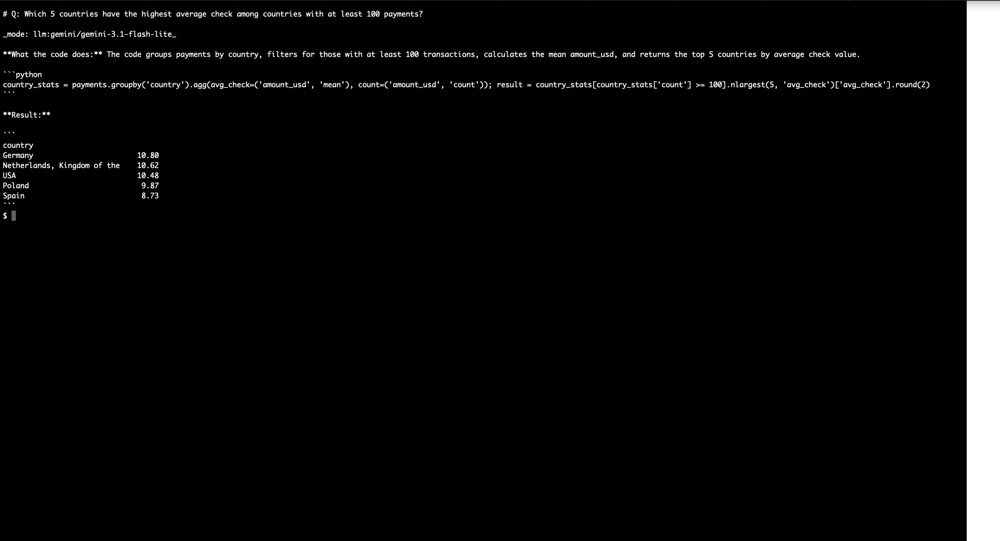
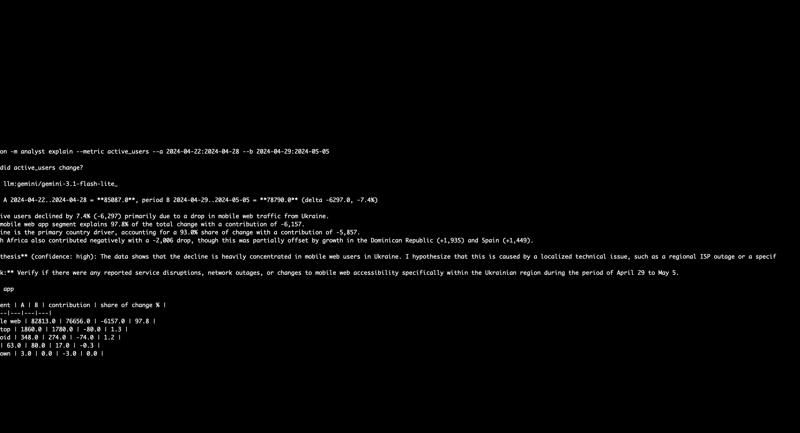
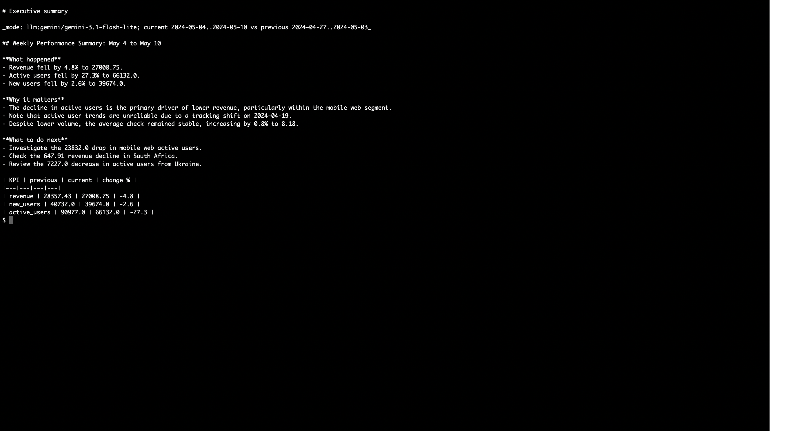
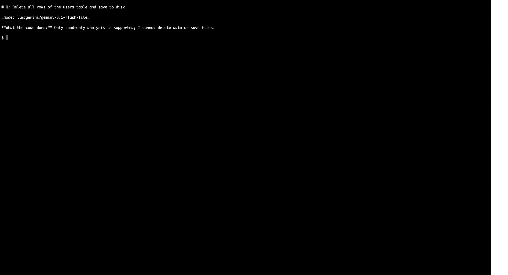

# Demo screenshots (real dataset, live Gemini model)

All commands were run on the lab 3 dataset (202,382 registrations, 11,330 payments, 547,860 session rows). pandas computes the numbers, the model only writes the interpretation, and the guardrail checks the numbers.

## 1. Automatic EDA - `python -m analyst eda`

The summary and findings are written by the model from the computed report. The anomaly list is computed in code (median/MAD on day-over-day change): active users jump from 1,802 to 23,265 on 2024-04-19. The data-quality section also notes 62,589 registrations older than the event window and the partial last day.

## 2. Hypotheses - `python -m analyst hypotheses`

Every hypothesis cites fact ids (F1..F9) and quotes their numbers; the line `guardrail: numbers verified against cited facts` is produced by code, not by the model.

## 3. Natural language to pandas - `python -m analyst ask "..."`

The generated code is shown, validated and executed; the result is a real table.

## 4. Explain a metric change - `python -m analyst explain ...`

The decomposition by app, country and feature is exact (contributions sum to the total change); the model names the drivers and proposes a hypothesis with a check.

## 5. Executive summary - `python -m analyst summary`

## 6. A destructive request is refused - `python -m analyst ask "Delete all rows ..."`

The tool is read-only: the prompt asks the model to refuse, and the code validator would block such code anyway (unit tests).

More outputs: `examples/` (including `04b_explain_revenue.md`, `06_retention.md`).
